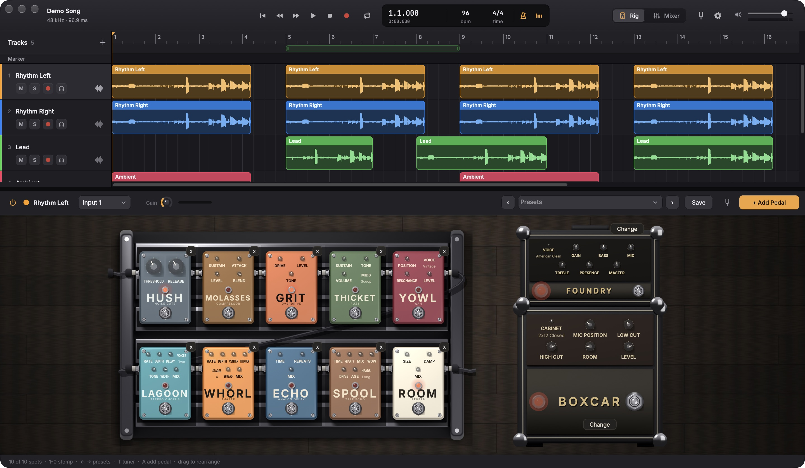
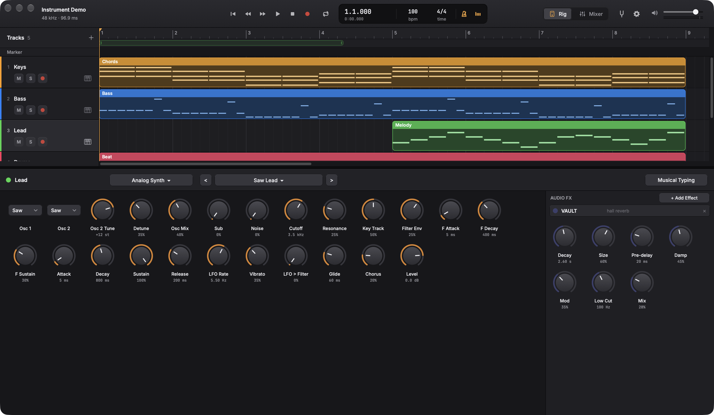
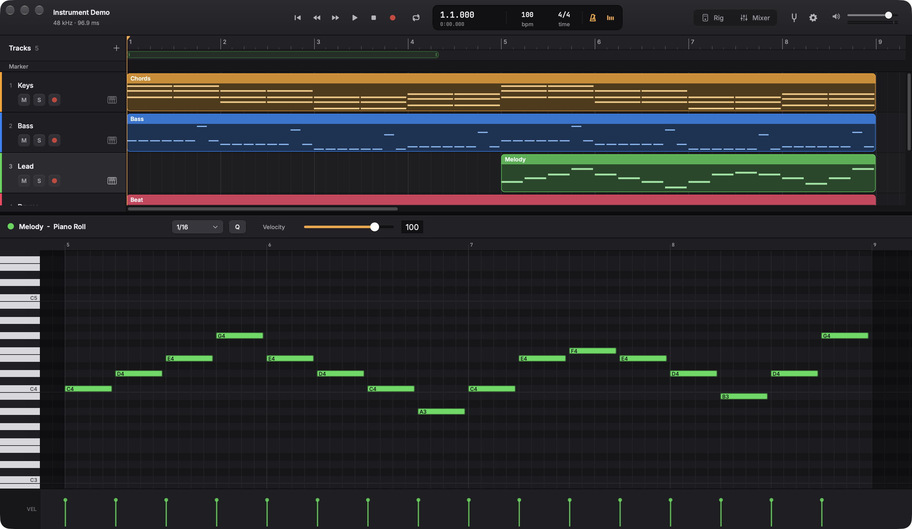
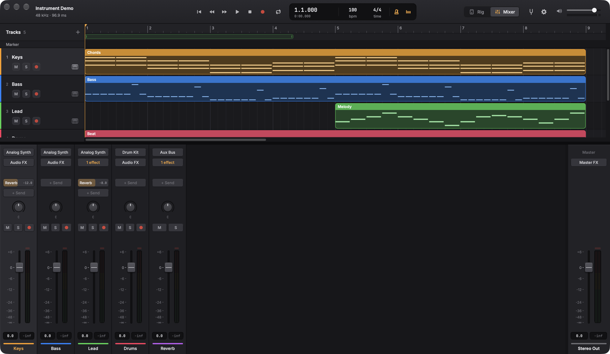
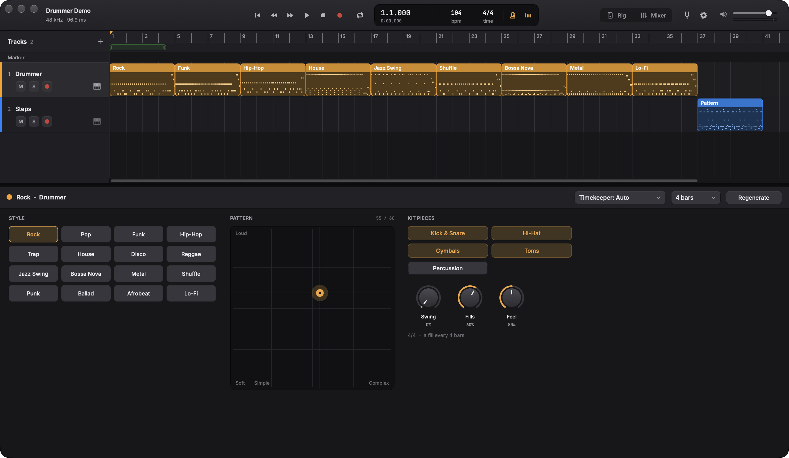
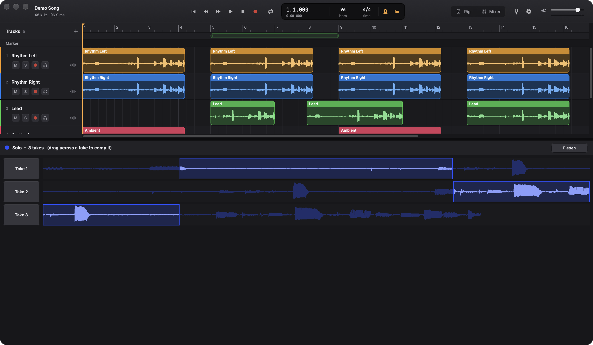
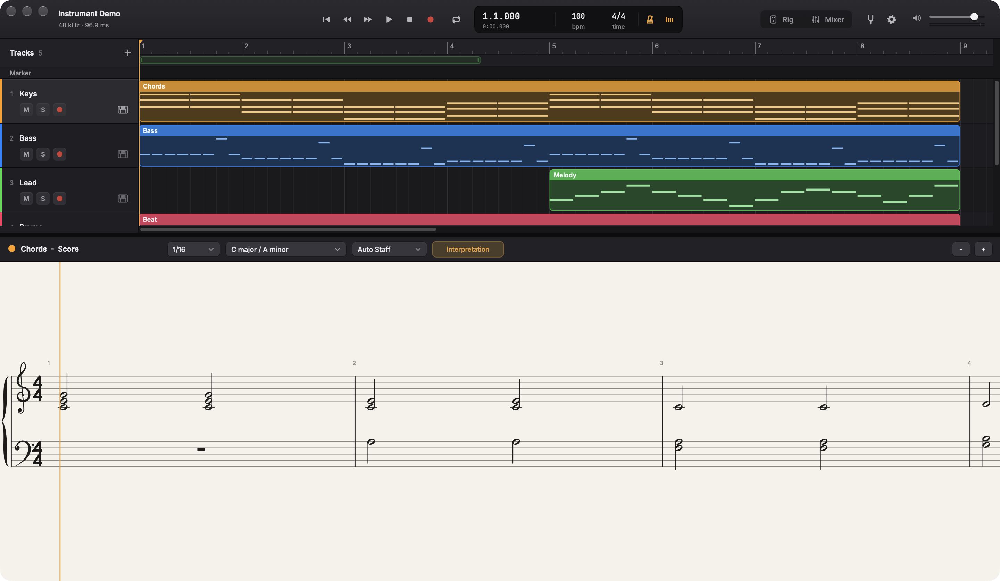

# Woodshed

Built by [willgerstung.com](https://willgerstung.com).

A free, open-source studio for making music: record, write, arrange and mix, with a full guitar
rig built in. No paywalls, no locked "pro" features, no paid sound packs. Everything here is
free for anyone to use, study and improve, under the GNU AGPLv3.



Woodshed started as a guitar pedalboard and grew into a full digital audio workstation. It's
modelled on the workflow of the big professional DAWs (if you know them, the key commands will
feel familiar), but it's its own program, written from scratch.

## What it does

**Recording and arranging**
- Audio tracks (through the guitar rig, or straight in for voice and microphones), software
  instrument tracks, Drummer tracks and aux buses
- Regions: move, trim, split, copy and paste (between projects too), repeat, loop, mute, nudge,
  fades and crossfades
- Cycle recording into take folders, with swipe comping
- Markers, tempo and time signature changes, count-in and click
- Live waveforms (and notes) while you record; latency-compensated takes
- Bounce to WAV, AIFF or FLAC at 16, 24 or 32-bit float, with normalize, or every track as a stem

**Instruments and MIDI**
- 18 built-in instruments with 111 sounds, all synthesized: grand piano, electric piano,
  tonewheel organ, clavinet, analog, mono, FM and pad synths, strings, brass, choir, plucked
  strings, electric bass, mallets and a drum kit (studio, 808, 909, electronic, lo-fi)
- Audio Unit and VST3 plug-ins, instruments and effects
- Piano roll, score (notation) editor, step sequencer and a Drummer that plays grooves in
  16 styles, with complexity, loudness, swing and fills
- MIDI keyboards, and Musical Typing on the computer keyboard (Cmd-K)
- Quantize, transpose, velocity; import and export MIDI files

**Mixing**
- Mixer with sends, aux buses and master effects
- 92 effects: dynamics, EQ, drive, amps and cabinets, modulation, pitch (including vocal pitch
  correction), delay, reverb and a drawer full of strange ones
- Automation for volume, pan, sends and every instrument and effect knob
- 215 factory guitar rig presets

| | |
|---|---|
|  |  |
|  |  |
|  |  |

## Not there yet

Woodshed is young. Things the big DAWs have that it doesn't yet: Live Loops, Flex Time and
Flex Pitch (time-stretching and editing audio pitch), Smart Tempo, a sampler instrument,
track stacks, groups and VCAs, punch in/out, track freeze, plug-in delay compensation, a
mastering assistant, surround and spatial audio, and video. Contributions are very welcome.

## Building

You need CMake 3.22 or later and a C++20 compiler. JUCE is downloaded automatically.

### macOS

```sh
cmake -S . -B build -G Xcode
cmake --build build --target WoodshedStudio --config Release
open build/WoodshedStudio_artefacts/Release/Woodshed.app
```

macOS ties microphone permission to an app's code signature, and an unsigned (ad-hoc) build
gets a new signature every time, so a rebuilt app silently loses its audio input. To avoid
that, create a code-signing certificate in Keychain Access (Certificate Assistant > Create a
Certificate, type Code Signing) named "Woodshed Local Signing"; the build then signs with it
automatically (or set `-DWOODSHED_SIGN_IDENTITY=<name>`). `tools/sign-mac.sh` re-signs a build
by hand.

### Windows and Linux

The code is cross-platform (JUCE), but these builds are new and untested on real machines; the
CI builds them on every push. On Windows, set `ASIO_SDK_PATH` to Steinberg's ASIO SDK for
low-latency audio interfaces.

### The bench

`woodshed-bench` checks the audio code without an interface or a screen:

```sh
cmake -S . -B build-bench -DWOODSHED_BENCH_ONLY=ON
cmake --build build-bench --target WoodshedBench
build-bench/WoodshedBench_artefacts/Release/WoodshedBench run          # every effect
build-bench/WoodshedBench_artefacts/Release/WoodshedBench project      # the engine
build-bench/WoodshedBench_artefacts/Release/WoodshedBench instruments  # every instrument and sound
```

`presets`, `drummer`, `score` and `pitchcorrect` test the rest; `demo-midi <folder>` and
`render-project <folder> <out.wav>` make and render a short song.

## Contributing

Pedals (effects) are the easiest place to start: `.claude/skills/create-pedal/SKILL.md` walks
through designing one, registering it and getting it past the bench. Every effect and instrument
must pass the bench before it ships.

`tools/testdata/guitar-di-48k.wav` is a short guitar DI used by the bench.

## License

Woodshed is free software: you can redistribute it and modify it under the terms of the GNU
Affero General Public License, version 3 (see [LICENSE](LICENSE)). Built with
[JUCE](https://juce.com) under the AGPLv3. The bundled fonts, Inter and JetBrains Mono, are
under the SIL Open Font License (see `art/fonts/`).
