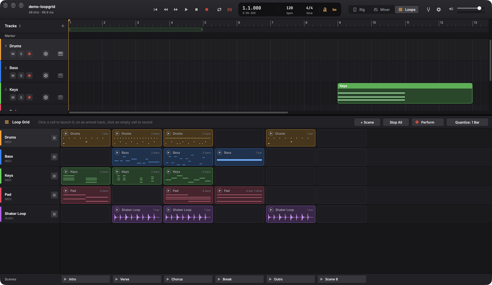
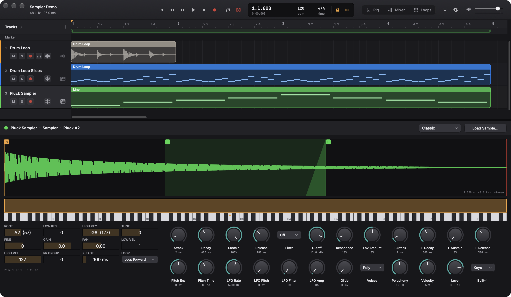
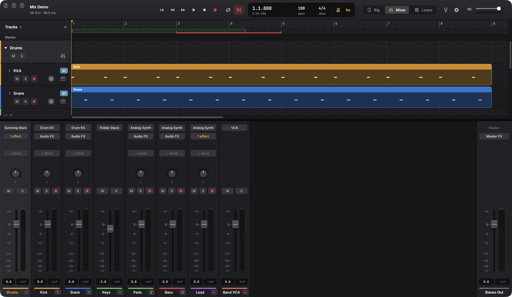
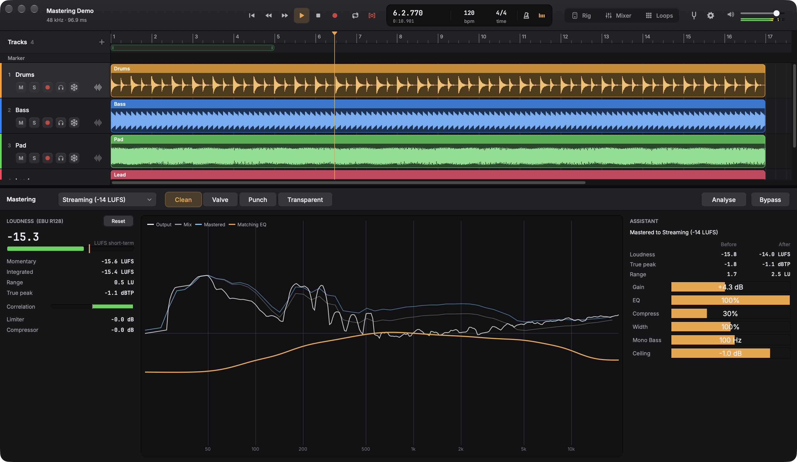
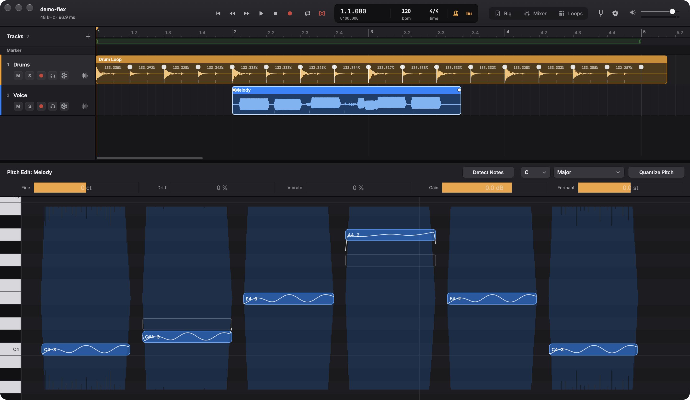
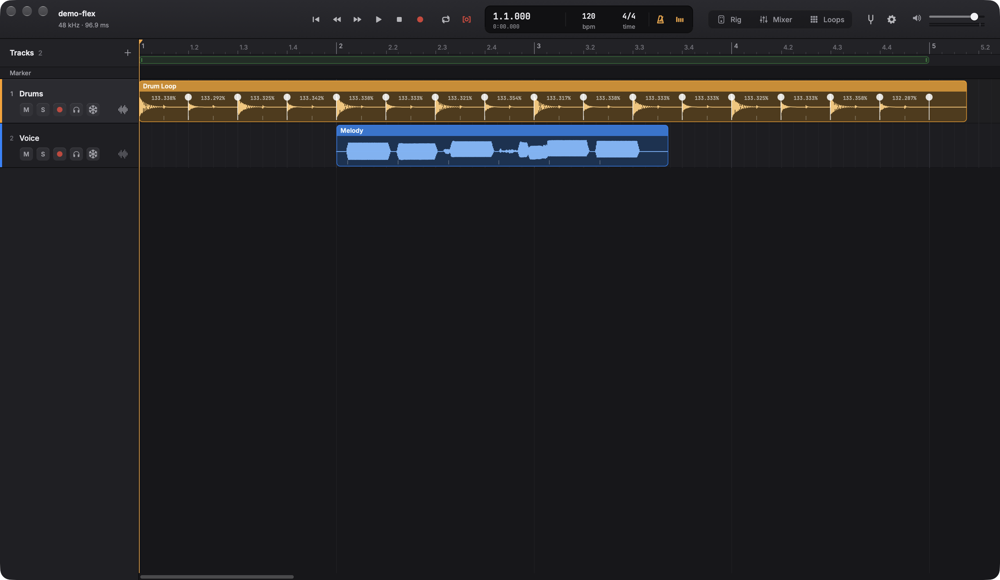

# Woodshed

Built by [willgerstung.com](https://willgerstung.com).

A free, open-source studio for making music: record, write, arrange and mix, with a full guitar
rig built in. No paywalls, no locked "pro" features, no paid sound packs. Everything here is
free for anyone to use, study and improve, under the GNU AGPLv3.


## Why I built it

I have an electric guitar, but I didn't have the money for the pedals, amps and cabinets that
make it sound like the records I love. A single good pedal can cost a hundred dollars or more,
and a real amp and a full pedalboard cost thousands. So I wanted an app where I could make any
kind of pedal I could think of, chain as many as I want, and run them through any amp.

That's how Woodshed started: a pedalboard on my laptop. Once I could get the tone, I wanted to
record with it and write songs around it, so it grew into a full studio. Music shouldn't sit
behind a paywall, so all of it is free.

How I use it:

- I plug my guitar into a small USB audio interface, put on headphones and play through the rig
  live, building a board out of the 93 effects and amps.
- When I learn a song, I rebuild its tone as a preset. "Paranoid" in the factory presets (a
  treble booster into a cranked British-style head) came from learning that riff.
- When the sound I want doesn't exist yet, I make a new pedal for it.
- I record my playing into tracks, then add drums, bass and keys around it with the Drummer and
  the built-in instruments.
- Every effect in the app is tested against a recording of my own guitar
  (`tools/testdata/guitar-di-48k.wav`).

Woodshed is modelled on the workflow of the big professional DAWs (if you know them, the key
commands will feel familiar), but it's its own program, written from scratch.

## What it does

**Recording and arranging**
- Audio tracks (through the guitar rig, or straight in for voice and microphones), software
  instrument tracks, Drummer tracks and aux buses
- Regions: move, trim, split, copy and paste (between projects too), repeat, loop, mute, nudge,
  fades and crossfades
- Cycle recording into take folders, with swipe comping
- Autopunch with punch locators and pre-roll, and quick punch while playing
- Track stacks (folder and summing), track groups, VCA faders and track freeze
- Loop Grid: a grid of loops and scenes to launch in time, record into cells, and record the
  performance back into the arrangement
- Markers, tempo and time signature changes, count-in and click
- Live waveforms (and notes) while you record; latency-compensated takes
- Time Stretch: stretch markers on transients, Monophonic, Polyphonic, Rhythmic (slicing) and
  Speed modes, quantize audio to the grid, and audio that follows tempo changes
- Pitch Edit: the notes of a voice or solo as blobs to drag, with fine pitch, drift, vibrato,
  gain, formants and quantize to a scale, rendered with a formant-preserving pitch shift
- Tempo Detect: finds a recording's tempo and downbeat; an empty song can take it, or the
  recording is conformed to the song's tempo
- Bounce to WAV, AIFF or FLAC at 16, 24 or 32-bit float, with normalize, or every track as a stem

**Instruments and MIDI**
- 19 built-in instruments with 117 sounds, synthesized or sampled: grand piano, electric piano,
  tonewheel organ, clavinet, analog, mono, FM and pad synths, strings, brass, choir, plucked
  strings, electric bass, mallets, a drum kit (studio, 808, 909, electronic, lo-fi) and the sampler
- Sampler: multi-zone, with Classic, One Shot and Slice modes, loops with crossfades, filter,
  envelopes and LFO; drop in a file or convert any audio region into a sampler track
- Audio Unit and VST3 plug-ins, instruments and effects, with plug-in delay compensation
- Piano roll, score (notation) editor, step sequencer and a Drummer that plays grooves in
  16 styles, with complexity, loudness, swing and fills
- MIDI keyboards, and Musical Typing on the computer keyboard (Cmd-K)
- Quantize, transpose, velocity; import and export MIDI files

**Mixing**
- Mixer with sends, aux buses and master effects
- Mastering: EBU R128 loudness meters (momentary, short-term, integrated, loudness range,
  true peak), correlation and a spectrum, and an assistant that masters the song to a
  loudness target (streaming, podcast, CD, club) with a matching EQ, bus compression, width
  and a true-peak limiter
- 93 effects: dynamics, EQ, drive, amps and cabinets, modulation, pitch (including vocal pitch
  correction), delay, reverb and a drawer full of strange ones
- Automation for volume, pan, sends and every instrument and effect knob
- 215 factory guitar rig presets

**Spatial audio and video**
- A 3D panner on every track (right-click the pan knob, or Track > 3D Panner...): direction,
  elevation, distance, spread and a little room, all automatable
- Binaural monitoring for headphones (Track > Binaural Monitoring): interaural time and level
  differences, head shadow, pinna and elevation cues, distance and air absorption, computed
  from a model of the head rather than a measured dataset; on speakers, 3D tracks pan in stereo
- Surround bounces to 5.1 and 7.1.4 WAV files, placed from the tracks' 3D positions
- Movies (File > Open Movie...): a movie window that follows the transport, a thumbnail strip
  above the tracks (drag it to move the movie's start), timecode, and Import Audio from Movie

| | |
|---|---|
|  |  |
|  |  |
|  |  |
|  |  |
|  |  |
|  |  |

## Not there yet

Woodshed is young, and every feature above is new and lightly used. Bug reports and
contributions are very welcome. Known gaps: the sampler can't record straight from an input
yet, Loop Grid cells play at the song's starting tempo and aren't time-stretched, and the
Windows and Linux builds are tested by CI but not yet by people.

Surround is bounce-only: the engine plays in stereo, so while you work you hear 3D tracks
binaurally on headphones (or panned in stereo), and the 5.1 and 7.1.4 mixes exist only as
bounced files. Those leave the LFE channel silent and skip the master effects. Movie playback
uses the system's player on macOS and Windows; on Linux there's no video yet, and the movie's
sound can be imported only where the system can decode it.

## Building

You need CMake 3.22 or later and a C++20 compiler. JUCE is downloaded automatically.

### macOS

```sh
cmake -S . -B build -G Xcode
cmake --build build --target WoodshedStudio --config Release
open build/WoodshedStudio_artefacts/Release/Woodshed.app
```

macOS ties microphone permission to an app's code signature, and an unsigned (ad-hoc) build
gets a new signature every time, so a rebuilt app silently loses its audio input. To avoid
that, create a code-signing certificate in Keychain Access (Certificate Assistant > Create a
Certificate, type Code Signing) named "Woodshed Local Signing"; the build then signs with it
automatically (or set `-DWOODSHED_SIGN_IDENTITY=<name>`). `tools/sign-mac.sh` re-signs a build
by hand.

### Windows and Linux

The code is cross-platform (JUCE), but these builds are new and untested on real machines; the
CI builds them on every push. On Windows, set `ASIO_SDK_PATH` to Steinberg's ASIO SDK for
low-latency audio interfaces.

### The bench

`woodshed-bench` checks the audio code without an interface or a screen:

```sh
cmake -S . -B build-bench -DWOODSHED_BENCH_ONLY=ON
cmake --build build-bench --target WoodshedBench
build-bench/WoodshedBench_artefacts/Release/WoodshedBench run          # every effect
build-bench/WoodshedBench_artefacts/Release/WoodshedBench project      # the engine
build-bench/WoodshedBench_artefacts/Release/WoodshedBench instruments  # every instrument and sound
```

`presets`, `drummer`, `score`, `pitchcorrect`, `mix`, `sampler`, `loopgrid`, `spatial`, `flex` and
`mastering` test the rest. `demo-midi <folder>` (and `demo-mix`, `demo-sampler`, `demo-loopgrid`,
`demo-spatial`, `demo-flex`, `demo-mastering`) write example songs, `render-project <folder>
<out.wav>` renders one, and `loudness <file>` measures a file's loudness.

## Contributing

Pedals (effects) are the easiest place to start: `.claude/skills/create-pedal/SKILL.md` walks
through designing one, registering it and getting it past the bench. Every effect and instrument
must pass the bench before it ships.

`tools/testdata/guitar-di-48k.wav` is a short DI recording of my guitar, used by the bench.

## License

Woodshed is free software: you can redistribute it and modify it under the terms of the GNU
Affero General Public License, version 3 (see [LICENSE](LICENSE)). Built with
[JUCE](https://juce.com) under the AGPLv3. The bundled fonts, Inter and JetBrains Mono, are
under the SIL Open Font License (see `art/fonts/`). Time Stretch and Pitch Edit use
[Signalsmith Stretch](https://github.com/Signalsmith-Audio/signalsmith-stretch) and its
[Linear](https://github.com/Signalsmith-Audio/linear) library by Geraint Luff / Signalsmith
Audio, under the MIT License (see `third_party/`).
